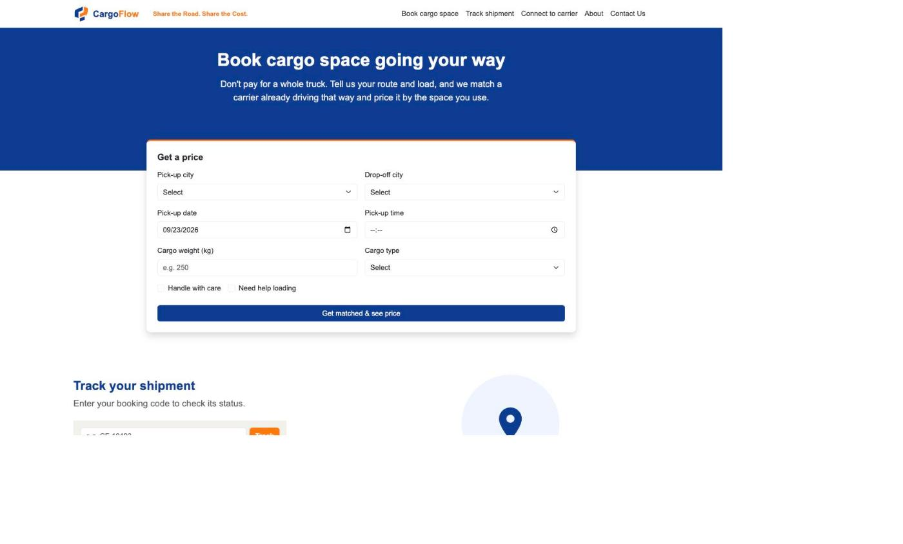
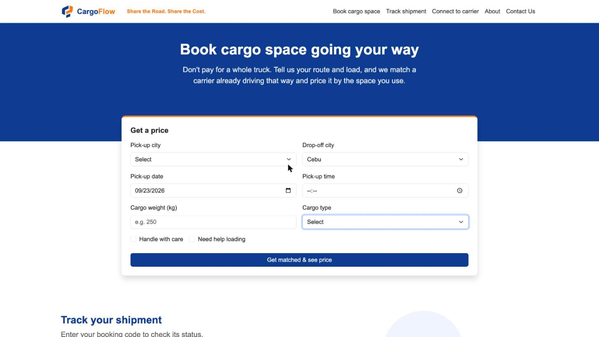
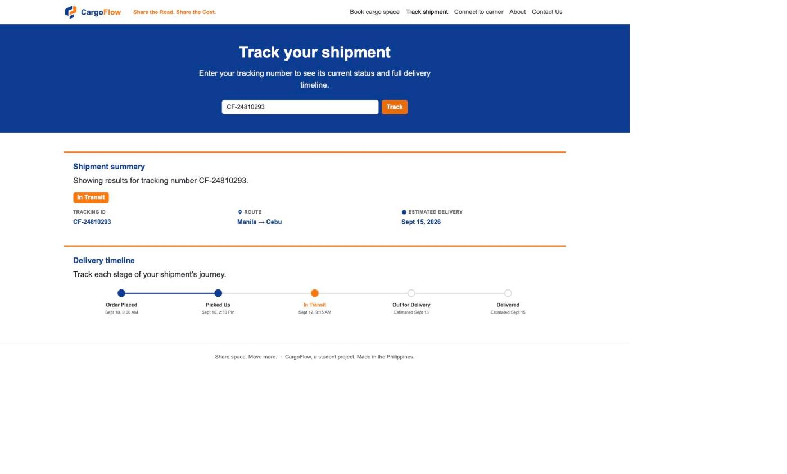

<div align="center">

# CargoFlow

### _Share the Road. Share the Cost._

**A browser-based cargo-sharing platform for the Philippines** — connecting SMEs, online sellers, manufacturers, independent shippers, and local carriers by matching partial shipments with unused truck capacity.


</div>

---

## About the Project

Shipping in the Philippines is expensive — especially for small businesses that can't fill an entire truck. Meanwhile, carriers often drive routes with **unused cargo space**.

**CargoFlow** solves both problems at once. Instead of simply booking a truck, CargoFlow **fills unused cargo space** by matching multiple compatible shipments traveling along the same route, based on:

- **Route** — shipments headed the same direction
- **Cargo size** — fits available space
- **Vehicle capacity** — matched to the carrier's truck
- **Delivery schedule** — aligned pickup and drop-off windows

> This project was developed as a requirement for **MO-IT161 – Web Systems and Technology**.

---

## Key Features

| Feature                  | Description                                                       |
| ------------------------ | ----------------------------------------------------------------- |
| **Smart Matching**       | Find compatible shipments and carriers going along the same route |
| **Cost Sharing**         | Split transport costs among multiple shippers sharing one truck   |
| **Cargo Booking**        | Reserve available cargo space in a few clicks                     |
| **Shipment Tracking**    | Monitor shipment status from pickup to delivery                   |
| **Account Profile**      | Keep your shipper details; they prefill new bookings              |
| **Direct Messaging**     | Chat with carriers; history is saved on the server through the messages API |
| **Capacity Utilization** | Help carriers earn more by filling empty truck space              |

---

## Target Users

- **SMEs** — small and medium enterprises with partial-load shipments
- **Online Sellers** — e-commerce merchants shipping to customers
- **Manufacturers** — businesses moving goods between locations
- **Independent Shippers** — individuals with occasional cargo needs
- **Local Carriers** — truck owners/operators with unused capacity

---

## Tech Stack

<div align="center">

|      Technology       |                                                      Logo                                                      | Purpose                                     |
| :-------------------: | :----------------------------------------------------------------------------------------------------------: | :------------------------------------------ |
|       **HTML5**       |            | Markup and page structure (`index.html`)    |
|       **CSS3**        |              | Styling, layout, and responsive design      |
| **JavaScript (ES6+)** |  | Icon rendering, mobile nav, and route search |
|  **Node.js + Express** |              | Backend (`server.js`): serves the site and the messages API |
|   **Git & GitHub**    |            | Version control and collaboration           |

</div>

> **Note:** No front-end framework and no build step. Plain HTML, CSS, and
> JavaScript, plus Bootstrap 5 (via CDN) across every page. A Node.js + Express
> backend (`server.js`) serves the pages and a REST API for carrier messages, which
> it stores in `data/messages.json` so chat history survives page reloads, server
> restarts and other browsers. See [Backend API](#backend-api). Shipment tracking
> uses mock data, and bookings and the account profile are still saved in the
> browser's `localStorage`.

---

## Getting Started

### Prerequisites

- [Node.js](https://nodejs.org/) 20 or newer (LTS recommended). Check with `node -v`.
- A modern web browser.

### Run it

```bash
git clone https://github.com/RTavera3/Web-Systems-and-Technology-CargoFlow.git
cd Web-Systems-and-Technology-CargoFlow
npm install      # first time only: installs Express and CORS
npm start
```

Then open **http://localhost:3000**. The terminal shows
`CargoFlow running on http://localhost:3000` once the server is up.

| Command       | What it does                                                             |
| ------------- | ------------------------------------------------------------------------ |
| `npm start`   | Runs the server (`node server.js`)                                       |
| `npm run dev` | Runs the server and restarts it whenever a file changes (`node --watch`) |

To check the backend is running, open **http://localhost:3000/api/health**.
Stop the server with `Ctrl + C`.

Keep the default port 3000 when using the chat: `js/messages.js` calls the API at
`http://localhost:3000`. The other pages work on any port (for example
`PORT=8080 npm start`).

The server only serves the front-end folders (`css/`, `js/`, `pages/`, `resources/`)
and `index.html`, so `server.js`, `package.json`, `node_modules/` and the saved
`data/messages.json` are never reachable from the browser except through the API. Serving over `http://` also lets the booking page load
`resources/users.json`, which browsers block when the HTML file is opened directly.
The payment, tracking, history and chat pages also load their scripts as ES modules,
which browsers only run over `http://`, so open the site through the server rather than
by double-clicking an HTML file.

### About the pages

`index.html` (project root) is the Home page — Bootstrap 5 navbar, hero with
a floating "Get a price" quote card, a shipment-tracking widget, a carrier
CTA, and an About section. Every other page lives under `pages/`:
`contact.html`, `booking-details.html`, `payment.html`, `messages.html`
(carrier chat whose history is saved on the server through the [messages API](#backend-api)), `trackshipment.html`
(the full tracking page, separate from the home page's quick widget),
`history.html` (Shipment History: every active and past booking, with status
filters, search and sorting; completed bookings appear there automatically), and
`profile.html` (Account Profile: the shipper's details, saved in this browser and
used to prefill the booking form and preferred payment method).

The design follows the CargoFlow brand palette: deep blue (`#0B3D91`) and
flow orange (`#FF7A00`), with sand (`#F4F1EA`) as a secondary background.
Icons are inline SVG (no icon font/CDN) to keep the site's look consistent
and working offline.

**Prototype scope:** shipment tracking and pricing use mock data, and there's no
database or real payment processing. The backend is deliberately lightweight: an
Express server that stores chat messages in a JSON file. No API keys are needed to
run it.

**Saved data:**

- **Chat messages** are saved on the server in `data/messages.json` through the
  [messages API](#backend-api). The server creates the file if it is missing.
- **Bookings** are kept in the browser's `localStorage`, through one shared module,
  `js/storage.js`. It owns the storage keys, never throws on missing or corrupted
  data, and records a storage version so data saved by an older version of the site
  is upgraded on the next visit.

Fonts load from Google Fonts, which receives normal browser request
metadata; system sans-serif fallbacks are used when offline.

---

## Backend API

The Express server in `server.js` exposes a small REST API under `/api`. Requests
and responses are JSON. The Messages page (`js/messages.js`) uses it to load, send
and clear the carrier chat, so the conversation is the same in every browser that
opens the site and is still there after the server restarts.

| Method   | Route           | What it does                                 | Success response |
| -------- | --------------- | -------------------------------------------- | ---------------- |
| `GET`    | `/api/health`   | Checks that the server is running            | `200` `{ "status": "OK", "message": "CargoFlow Messaging Server is Running!" }` |
| `GET`    | `/api/messages` | Returns the whole chat history, oldest first | `200` an array of messages |
| `POST`   | `/api/messages` | Saves one new message                        | `201` `{ "message": "Message saved successfully.", "data": { ...the saved message } }` |
| `DELETE` | `/api/messages` | Deletes every message                        | `200` `{ "message": "All messages deleted successfully." }` |

### Sending a message

Request body for `POST /api/messages`:

```json
{ "text": "Is my shipment on schedule?", "sender": "Shipper", "recipient": "Carrier" }
```

`text` is required. `sender` and `recipient` are optional and default to
`"Shipper"` and `"Carrier"`. The server trims the text, adds an id and a timestamp,
and saves it:

```json
{
  "id": "1792038594020",
  "sender": "Shipper",
  "recipient": "Carrier",
  "text": "Is my shipment on schedule?",
  "timestamp": "2026-10-15T04:29:54.020Z"
}
```

### Validation and errors

| Situation                                    | Status | Response body |
| -------------------------------------------- | ------ | ------------- |
| `text` missing, not a string, or only spaces | `400`  | `{ "error": "Message text cannot be empty." }` |
| `text` longer than 500 characters            | `400`  | `{ "error": "Message exceeds the 500 character limit." }` |
| Request body is not valid JSON               | `400`  | Express's default error page |
| The messages file can't be read or written   | `500`  | `{ "error": "Failed to read messages." }` (or `save` / `delete`) |
| Any other path                               | `404`  | `Page not found` |

### Trying it from a terminal

With the server running (`npm start`):

```bash
curl http://localhost:3000/api/health
curl http://localhost:3000/api/messages
curl -X POST http://localhost:3000/api/messages \
  -H "Content-Type: application/json" \
  -d '{"text":"Hello from curl"}'
curl -X DELETE http://localhost:3000/api/messages
```

### Where the data lives

Messages are stored in `data/messages.json` as a JSON array. If the folder or file
is missing, the server creates it with an empty array (`[]`) at startup and before
each write. To reset the chat, use the trash icon on the Messages page, call
`DELETE /api/messages`, or stop the server and replace the file's contents with `[]`.

---

## Project Structure

```
Web-Systems-and-Technology-CargoFlow/
├── server.js                     # Express backend: serves the site and the /api routes
├── package.json                  # Project info, npm scripts (start, dev), Express and CORS
├── data/
│   └── messages.json             # Chat history saved by the messages API (created if missing)
├── index.html                    # Home page: hero, quote form, track widget, carrier CTA, about
├── css/
│   └── theme.css                 # Shared Bootstrap theme overrides for every page (navy/orange brand)
├── js/
│   ├── storage.js                # Shared localStorage module for bookings and the profile, with versioning
│   ├── track.js                  # Home page's quick shipment-tracking widget
│   ├── trackshipment.js          # Full tracking page logic (pages/trackshipment.html)
│   ├── history.js                # Shipment History list, filters, search and sort (pages/history.html)
│   ├── profile.js                # Account Profile form (pages/profile.html)
│   └── messages.js               # Carrier chat: loads, sends and clears messages through the API
├── pages/
│   ├── contact.html              # Contact form
│   ├── booking-details.html      # Cargo/address details step of the booking flow
│   ├── payment.html              # Payment step of the booking flow
│   ├── messages.html             # Carrier messaging UI
│   ├── trackshipment.html        # Full shipment-tracking page (accepts ?code=CF-... to search directly)
│   ├── history.html              # Shipment History: active and past bookings
│   └── profile.html              # Account Profile: shipper details used to prefill bookings
└── resources/
    └── cargoflow.logo.png        # Brand logo asset
```

`index.html` stays at the project root (so `index.html` loads by default from any static host);
every other page lives under `pages/`. Pages link to each other with plain relative paths — no
build step, router, or bundler is involved.

---

## Core Pages

1. **Home** — platform overview and quick search
2. **Book Cargo Space** — reserve space and view shared cost breakdown
3. **Track Shipment** — see shipment status and timeline
4. **Shipment History** — view active and past bookings, filter by status, search, and open any one to track it
5. **Account Profile** — manage shipper details used to prefill bookings
6. **Messages** — chat directly with carriers; history is saved on the server

---

## Screenshots

|                Home                 |               Book Cargo                |              Tracking               |
| :----------------------------------: | :--------------------------------------: | :-----------------------------------: |
|  |  |  |

---

## Team

| Name                  |
| --------------------- |
| Armielyn Obinguar     |
| Chantal Louise Flor   |
| Mitzi Reese Arrogante |
| Ryan Keneth Tavera    |

---

## Links

| Link Text | Link URL |
| :--- | :--- |
| **Application Development Worksheet** | [Application Development Worksheet](https://docs.google.com/spreadsheets/d/1dY_Oe7DcTmbCF5gs7h_8In5pB499XdTnBrwlWs6sxXw/edit?usp=sharing) |
| **Project Plan** | [Project Plan](https://docs.google.com/spreadsheets/d/138MnAb0N5k0tvgI0hg_GSXMYZVBpTThv79Nch-e4GCY/edit?usp=sharing) |
| **AI Use Statement** | [AI Use Statement](https://docs.google.com/document/d/1LYv0N-MkpsaRtzsQQ7X2heC_45hTNs3Z9yNxwxWlT0I/edit?tab=t.0) |

## Course Information

- **Course Code:** MO-IT161
- **Subject:** Web Systems and Technology
- **Term:** Term 1, SY 2026–2027
- **Program:** Bachelor of Science in Information Technology
- **Section:** A3101
- **Institution:** Mapúa Malayan Digital College (MMDC)

---

<div align="center">

Made in the Philippines

</div>
